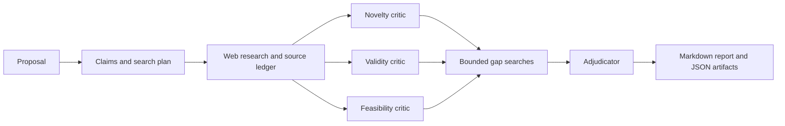

# Idea Teardown

Evidence-grounded adversarial review for research proposals, product ideas, and
technical plans.

Idea Teardown turns a proposal into testable claims, searches for supporting and
contradicting evidence, and asks independent reviewers to challenge its novelty,
validity, and feasibility. A final adjudicator ranks the objections and turns the
most important uncertainties into cheap experiments and explicit rejection tests.

It is designed for serious early feedback: useful before a postdoc application,
grant submission, design review, or high-cost build. It does not pretend that a
language model replaces domain expertise or a systematic literature review.

## What it produces

- A strongest-version restatement of the proposal.
- Load-bearing claims with assumptions and falsifiers.
- Web-backed objections with source excerpts and URLs.
- Independent novelty, methodology, and feasibility reviews.
- A decision: proceed, revise, test first, reject, or insufficient evidence.
- Concrete next actions, cheap discriminating tests, and rejection thresholds.

The tool uses an OpenAI-compatible LiteLLM gateway for model access and Tavily for
web research. It keeps the workflow deliberately bounded and saves intermediate
artifacts so an interrupted run can be resumed.

A small Python CLI for adversarial review of ideas, research proposals and project
plans, using your LiteLLM models and internet evidence. Three runtime dependencies
for proxy mode: `httpx`, `pydantic` and `python-dotenv`. Python 3.11+.

## Architecture



The controller owns the workflow and budgets. Models propose queries and critiques;
they cannot execute code or fetch arbitrary URLs. Three independent review calls
share the evidence but do not see one another's outputs. The adjudicator checks
their objections against the strongest version of the proposal and new evidence.
Every finding includes a defense, a cheap test and a rejection threshold.

This bounded workflow is a practical starting point: five model calls, at most
four initial searches and two gap searches by default. No agent framework,
database, vector store, multi-round debate or background workers. Different model
families are optional per critic; multiple calls are not independent truth checks.

## Setup

```bash
python -m venv .venv
source .venv/bin/activate
pip install -e .

# For a fresh checkout, create a local credentials file if it does not exist.
cp -n .env.example .env
```

Fill in `LITELLM_BASE_URL`, `LITELLM_API_KEY` and `TAVILY_API_KEY` in `.env`.
The CLI automatically loads `.env` beside the selected TOML config, including when
you use `--config` from another directory. Existing shell variables take precedence.
Values are read literally without `${...}` expansion. `.env` is ignored by Git;
`.env.example` contains only the template. No shell `source` command is needed.

Edit `[models]` in `teardown.toml` with aliases from your own gateway. `planner`
can use a cheaper model; `critic` and `judge` should use your stronger reasoning
models. Optional `novelty`, `validity` and `feasibility` override the critic model.
The base URL can include a gateway path prefix or `/v1`; the client appends
`/chat/completions`. `LITELLM_BASE_URL` overrides the TOML URL. Unauthenticated local
gateways can omit `LITELLM_API_KEY`.

```bash
# Validate input and configuration; no credentials or network calls needed.
teardown --file examples/proposal.md --dry-run

teardown --file examples/proposal.md
teardown --text 'My proposal and its constraints go here' --out runs/my-review
cat examples/proposal.md | python -m teardown --stdin
```

Input is Word `.docx`, UTF-8 text or Markdown, up to 60,000 extracted characters.
For a Word proposal, run:

```bash
source .venv/bin/activate
teardown --file "/path/to/postdoc-proposal.docx" --dry-run
teardown --file "/path/to/postdoc-proposal.docx"
```

The dry run checks local input/configuration without contacting any provider; it
does not check whether credentials or model aliases work. The real run prints
progress and the path to `runs/<run-id>/report.md` when finished. Open that file
for the review. The extracted proposal is retained in that run's `input.json`.

If a run fails at the judge, resume from its saved research:

```bash
teardown --resume runs/<failed-run-id>
```

This uses your current TOML configuration, reuses the saved claims, evidence and
valid reviews, retries missing/invalid reviews, and runs the judge again. No web
searches are repeated and no Tavily key is needed for resume. A new output directory
preserves the original run. It requires `input.json`, `plan.json` and `sources.json`
from a completed research stage. Report accounting covers only the resumed model
calls; the query list describes reused research.

For reasoning models that exhaust the output budget, set a stage override such as
`judge_max_output_tokens = 12000` inside `[llm]`. The base `max_output_tokens` still
applies to other stages; overrides also support `plan`, `novelty`, `validity` and
`feasibility`. Larger output limits can increase cost. Empty responses are logged
with finish reason, returned usage and response-shape metadata and retried once.
Reasoning content is never substituted for a missing final answer.

Word extraction reads body paragraphs and tables, retaining inserted text and
omitting tracked deletions. It does not extract images, equations, footnotes,
headers, comments or formatting. Put any essential information from those into
body text before reviewing. Older `.doc` files must be saved as `.docx` or plain
text in Word/LibreOffice first. Extract PDF text before supplying it.

Include your objective, claimed contribution, baselines,
constraints, evidence so far, success criteria and known uncertainties.

### Direct LiteLLM SDK instead of a proxy

```bash
pip install -e '.[sdk]'
```

Set `llm.backend = "sdk"` and use LiteLLM `provider/model` names for each role.
Set the provider environment variables your SDK configuration needs. Proxy URL
and proxy key variables are only used by the proxy backend.

## Outputs and evidence quality

Each run creates a fresh directory in `runs/` containing:

- `report.md`: verdict, ranked objections, defenses, falsification tests, strengths,
  uncertainties and next actions.
- `report.json`: structured report, source text, query list and returned token usage.
- `input.json`, `plan.json`, `review.*.json`, `sources*.json`: intermediate stages.
- `search.*.json` and each model stage's numbered JSON: search responses and model
  outputs, including unsuccessful attempts. Failed runs retain completed artifacts.

The search adapter uses Tavily advanced search with page extraction when available,
and explicitly labels fallback search excerpts. URLs are deduplicated; text and
source counts are bounded. The source ledger preserves retrieval time and query
provenance. Citations must reference a real source ID and a whitespace-normalized
verbatim quote in the retained source text. Findings also reference valid claim IDs.

These checks establish provenance, **not entailment or truth**. The adjudicator is
prompted to assess relevance and source quality, but this is still a model judgment.
Review decisive sources yourself. Excerpts may omit context; search is not a
systematic literature review. Empty results never establish novelty. Retrieved
text and proposals are treated as data in prompts; prompt-injection resistance is
best effort, and no execution tools are exposed to models.

## Limits and failure handling

- One structured-output/citation repair per stage, at most 10 model calls.
- Each HTTP operation retries transient failures once; SDK mode delegates one retry
  to LiteLLM. Retries can incur additional charges.
- At most six logical search queries by default, four results each, 20 retained
  sources, 5,000 characters each. These are configurable in TOML. Context is bounded
  in characters, not tokens; lower these limits for small-context models.
- No local dollar-cost estimate or hard spend cap. Use your gateway/provider budget
  controls. The tool records model token usage when returned by the provider.
- Search failures produce explicit report limitations. A failed critic is omitted
  with a warning; failure of all critics, planning or adjudication fails the run.
- JSON mode is opt-in to accommodate model differences. There is no silent model
  fallback. The selected chat models must return text and accept `max_tokens`.
- Existing `--out` directories are rejected. Runs save proposal and retrieved text
  locally, and send proposal content to your model provider and generated search
  queries to Tavily. Credentials belong in environment variables, not TOML/artifacts.

## Verification

```bash
python -m unittest discover -s tests -v
```

Tests use mocked HTTP/model responses, including an end-to-end run. They require
no API keys or paid calls. A live run is needed to assess your selected models'
quality and gateway compatibility.

API references: [LiteLLM gateway and SDK](https://docs.litellm.ai/),
[Tavily Search](https://docs.tavily.com/documentation/api-reference/endpoint/search).
